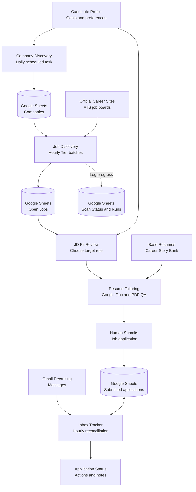

# AI-Assisted Job Application Lifecycle Platform

**From finding companies to handling recruiting replies: a stateful, human-in-the-loop AI workflow backed by Google Sheets.**

A personal engineering project connecting **company discovery → official ATS job monitoring → fit evaluation → evidence-backed resume tailoring → human-submitted applications → Gmail reconciliation**, with **persistent operational state, checkpoints, per-company failure diagnostics, and auditable decisions**.

> **What this repository is:** a public architecture and engineering case study, with synthetic workflows, schemas and failure examples. The actual connected Google Sheets/Gmail/Docs data and scheduled ChatGPT task prompts are **private**. The three linked implementation repos are separate artifacts; this portfolio does **not** claim they are one deployed codebase.

## At a glance

| Dimension | Design / evidence |
| --- | --- |
| Workflow execution | Daily company-discovery task, hourly ATS job-monitoring task, separate hourly Gmail inbox tracker |
| Source of truth | Google Sheets: Companies, Open Jobs, submitted Applications (privately named Sheet1), Scan Status, Scan Runs |
| Human controls | Select job, approve material resume edits, submit applications, confirm tracking updates |
| Job identity | Official ATS provider + company namespace + requisition ID; normalized role-specific URL as fallback |
| Reliability | Per-tier batches (up to 25), checkpointed rotation, blocked/not-attempted classification, status-safe upsert and readback |
| Examples of real operating results | **145 companies** and **512 tracked job records** at the 2026-10-12 snapshot; **not** current live-opening or accuracy counts |
| Inbox impact | About **300 recruiting/application emails over ~3 weeks**, **user estimate**, not an audited KPI |

## Architecture

### End-to-End Workflow

This is the **complete lifecycle diagram**. Its taller layout, shorter labels and wider spacing are intended to remain readable in GitHub Markdown, including on narrower screens. For the annotated stages and write boundaries, see [Full Workflow](docs/end-to-end-workflow.md) and [Architecture Details](docs/architecture.md).



**Boundary matters:** the local Python/SQLite ATS collector is a manually triggered precursor; the Google Sheets schedules are a separate ChatGPT-tool-based runtime. Scheduler prompts are instructions, **not** a self-hosted worker or guaranteed notifications. **No application is submitted automatically.**

**Diagram note:** Discovery, resume generation and Gmail tracking are **separate orchestrated workflows**, not one deployed service. The candidate manually submits applications. Google Sheets stores operational state, and Run/Status records support diagnosis.

## Three implementation repositories

| Repository | What it owns |
| --- | --- |
| [search-job](https://github.com/sophiesun7119/search-job) | Script-first Python/SQLite ATS ingestion: seven provider adapters, normalized identities, scan results and repeatable local tooling |
| [search-job-scheduler-prompt-tool](https://github.com/sophiesun7119/search-job-scheduler-prompt-tool) | Reusable profile-to-prompt authoring for company and jobs tasks; **generates prompts, does not execute schedules** |
| [ai-resume-tailoring-agent](https://github.com/sophiesun7119/ai-resume-tailoring-agent) | Evidence-to-JD matching, base-resume selection, human-reviewed edits, Google Docs copy and one-page PDF checks when tools are available |

This **fourth repository** explains their relationship and the additional private scheduling, Google Sheets, Gmail and human-approval orchestration. It does not duplicate their full code.

## A recruiter-friendly walkthrough

1. **Discover a company:** daily research builds and curates a prioritized company watchlist; irrelevant companies are excluded instead of blindly growing a quota.
2. **Discover an opening:** an hourly task selects at most 25 eligible companies in one tier, checks official ATS links, deduplicates IDs/URLs and preserves previously Applied/Skip/Closed decisions.
3. **Review fit:** rank the newly found or unprocessed role using technical match, location, experience and the candidate's intended direction.
4. **Tailor a resume:** choose the strongest base (e.g. backend/cloud/AI), compare JD requirements with actual Story Bank evidence, propose scoped edits, and only create a separate resume after approval.
5. **Apply manually:** the candidate—not the agent—submits the application, then confirms it for inclusion in the application table.
6. **Track replies:** an hourly Gmail task reconciles mail with **already-existing** applications, protects status precedence and flags assessments, interviews, rejections and human follow-ups.
7. **Inspect operations:** Scan Runs stores run receipts and coverage checkpoints, while Scan Status stores per-company failures and cumulative reasons; partial work is reported as PARTIAL, not invented success.

See the [full fictional end-to-end trace](docs/end-to-end-walkthrough.md).

## Read the engineering deep dives

- [System boundaries and data ownership](docs/architecture.md)
- [Google Sheets as operational state](docs/data-model.md)
- [Batch rotation, retry safety, logs and partial failures](docs/reliability-and-observability.md)
- [Gmail matching, stage transitions and human approval](docs/inbox-and-decisions.md)
- [How the system evolved and why](docs/engineering-decisions.md)
- [Real vs. template vs. planned: implementation status](docs/implementation-status.md)
- [Known gaps, especially scheduler policy drift](docs/limitations-and-roadmap.md)
- [Interview-ready talking points](docs/interview-guide.md)
- [Privacy boundaries and synthetic examples](docs/privacy.md)

## Sample run (synthetic)

```text
Open Jobs hourly: PARTIAL | Tier B - Batch 2
Assigned 4 | Checked 2 | Blocked 1 | Not attempted 1
New 1 | Updated 0 | Closed 0
Blocker: ExampleDB — DYNAMIC_CONTENT (official listing did not load)
Not attempted: DemoCloud — execution budget exhausted
Run receipt: PARTIAL; checkpoint persisted; retry prioritization remains
```

The sample shows how the reporting model works; it is **not an actual run log**. Inspect [mock log records](examples/scan-runs.synthetic.json) and [synthetic lifecycle events](examples/lifecycle-events.synthetic.json).

## Credible metrics, clearly scoped

The 2026-10-12 snapshot recorded **145 distinct company names** and **512 populated job records with role links** in the connected Sheet. These counts can grow and do not prove all roles remain open. The *separate* Python/SQLite prototype documented **78 seeded companies, 75 completed board checks and 14,178 deduplicated job identities** in its own recorded scan—**do not combine** those with scheduled-Sheet metrics. Inbox volume (~300 emails/~3 weeks) is a user estimate. There is no audited cost saving, exactly-once guarantee, delivery success rate or total hours-saved claim.

## Running it yourself

This **portfolio repository is not an installable integrated service**. For reusable parts, open the three linked repositories and follow their own setup instructions. The original runtime depends on separately authorized Google Sheets, Docs, Drive, Gmail, official web access and independently configured scheduled tasks. Do not copy private user prompts, credentials, Google resource IDs or live application records.

**Design principle:** Use deterministic tools for stable identities and state; AI for judgment-heavy investigation and resume evidence; humans for decisions and submission.

[MIT License](LICENSE) · [Implementation status](docs/implementation-status.md) · [Privacy](docs/privacy.md)
