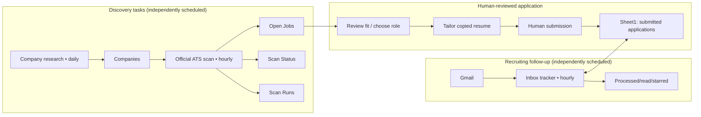

# Architecture and system boundaries

## Core system

This is a **connected-assistant workflow**, with three recurring AI task prompts and a shared Google Sheet; it is **not** a single server deployed with the three GitHub repos. Data-producing tasks use authorized Google connectors and web retrieval. Company/job schedules must never write the application-submission table; the inbox tracker must never invent applications.

## Concrete responsibilities and permissions

| Component | Inputs | Owned writes | Not allowed |
| --- | --- | --- | --- |
| Company Discovery | Current Companies + public company sources | Curated company rows, score/notes under authorized fields | Applicant records, job rows, resume edits |
| Open Jobs Discovery | Current eligibility (Companies), **entire** Open Jobs history, official ATS, scan checkpoints | Open Jobs, Scan Status, Scan Runs; due Cooldown→Active eligibility transition only when policy allows | Applications/Sheet1, Gmail, submitted status |
| On-demand company review | Official site + prospective jobs + candidate profile | New verified roles/user decisions only with consent | Reinterpreting old Applied/Skip/Closed |
| Resume Tailoring Agent | Official/pasted JD, candidate profile, Base resumes and Story Bank | New copy in Drive folder after approval; PDF export if supported | Original resume/Story Bank, actual application |
| Human | Tailored resume + official application site | Submission performed **outside** automation | N/A |
| Job Inbox Tracker | Gmail + existing Sheet1 application rows | Sheet1 status metadata/notes; Gmail processed/read/starred state | New application rows inferred from email; Company/Open Jobs tabs |

**Google Sheets is the operational state store, not a traditional transactional database.** Reads/writes can race with manual edits and schedules. The design uses explicit IDs, dedup checks, scoped writes and readback, not guaranteed database transactions or exactly-once delivery.

## Independent implementation repositories

- **Python/SQLite precursor**: [search-job](https://github.com/sophiesun7119/search-job). Seven ATS provider adapters, local database, repeatable scripts and manual refresh. It does **not** directly implement the hourly Google Sheets automation.
- **Prompt authoring**: [search-job-scheduler-prompt-tool](https://github.com/sophiesun7119/search-job-scheduler-prompt-tool). Templates and acceptance cases that *produce* two standalone prompts. Generator starter defaults differ from the evolved saved runtime; see [known drift](limitations-and-roadmap.md).
- **Resume Skill**: [ai-resume-tailoring-agent](https://github.com/sophiesun7119/ai-resume-tailoring-agent). Standalone prompt/skill instructions for evidence-backed JD-to-resume work, with optional tracker integration.
- **This repository**: documentation, grounded tradeoffs and **synthetic** logs. No private task prompt, Google Sheet export, Gmail content or personal candidate profile is included.

## External services and trust boundaries

1. Public official careers / ATS content is treated as potentially stale, incomplete and untrusted. A failed ATS fetch does **not** establish the role is closed.
2. Google Sheets/Docs/Drive are private, connector-authorized user data. A pasted URL does **not** grant authorization or prove write permission.
3. Gmail message content and identities require conservative matching. Generic ATS sender domain alone is not enough.
4. Resume language must be grounded in candidate-owned experience; the AI cannot autonomously fill unsupported qualifications.
5. Application submission is a deliberate human action; Sheet1 records verified submission claims separately from job discoveries.

## Recovery topology

The Open Jobs task uses `Run ID` and `Coverage State` as persistent checkpoints, with `Scan Status` tracking last-check, failure categories and counts. The inbox task uses `JobTracker/Processed` and the existing Sheet1 row states for incremental reconciliation, with separate search logic for blank-status historical applications. **Neither acts like an atomic cross-service transaction.**

See [reliability and observability](reliability-and-observability.md) for failure paths and accounting.
