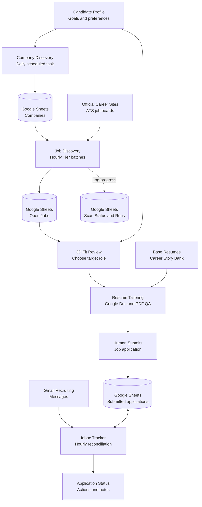

# Full End-to-End Workflow

This is the expanded, readable version of the **AI-Assisted Job Application Lifecycle Platform** diagram shown on the [repository homepage](../README.md#end-to-end-workflow).

The system is a **human-in-the-loop collection of independently scheduled tasks and connected assistant workflows**. The three public implementation repositories are separate and do **not** execute as a single deployed microservice. All entries here are architectural explanations, not personal Google Sheet or Gmail data.

## Complete lifecycle diagram

## Step-by-step ownership

| Stage | Trigger | Main read | Main write or output | Human gate |
| --- | --- | --- | --- | --- |
| Company Discovery | Daily task | Candidate preferences, existing Companies, public sources | Companies watchlist | No automatic application |
| Job Discovery | Hourly scheduled Tier batch | Eligible Companies, existing Open Jobs, official ATS | Open Jobs + Scan Status + Scan Runs | Protect Applied/Skip/Closed decisions |
| Job Review | User reviews new/unprocessed roles | JD, Candidate Profile, resume evidence | Prioritized official job links | **User selects role** |
| Resume Tailoring | User-selected JD | Base resumes and Story Bank | Independent Google Doc; PDF only when exported and visually checked | **User approves material edits** |
| Application | User acts outside automation | Official job application page | Manual submission, then confirmed application record in Sheet1 | **User submits** |
| Inbox Tracking | Hourly task | Gmail messages and existing Sheet1 application rows | Status, notes, action flag; processed/read/starred Gmail state | Ambiguous cases require human review |
| Observability | Each eligible jobs scan | Assigned batch + observed fetch/write results | Checkpoint, per-company statuses and run receipt | Failures remain visible |

## Three independent components

The [Python/SQLite collector](https://github.com/sophiesun7119/search-job) is a script-first ATS research implementation. It does not run the connected Google Sheets hourly schedule.

The [Scheduler Prompt Tool](https://github.com/sophiesun7119/search-job-scheduler-prompt-tool) helps generate company/job scheduler prompts. It does not run or update the user's already deployed schedules by itself; generic template policies must be reconciled with saved runtime prompts.

The [Resume Tailoring Agent](https://github.com/sophiesun7119/ai-resume-tailoring-agent) maps JDs to **verified** candidate experience and requests approval before modifying a **copy** of a base document.

## Why the operations branch is separate

Job scanning writes three different logical records: prospective job identities (Open Jobs), most recent per-company assessment and failure history (Scan Status), and per-run batch/checkpoint receipts (Scan Runs). This separation helps distinguish a real zero-job scan from an inaccessible ATS and a company that was never attempted.

The Gmail tracker instead owns recruiting communication updates to **existing submitted applications**. A Gmail message alone does not create a new application.

## Further engineering detail

- [System architecture and ownership](architecture.md)
- [Google Sheets state model](data-model.md)
- [Scan recovery and failure classification](reliability-and-observability.md)
- [Gmail reconciliation and state precedence](inbox-and-decisions.md)
- [Known limitations and prompt drift](limitations-and-roadmap.md)

**Privacy:** This diagram includes no live Google IDs, email content or personal job records. For fictional events, see [synthetic lifecycle example](../examples/lifecycle-events.synthetic.json).
