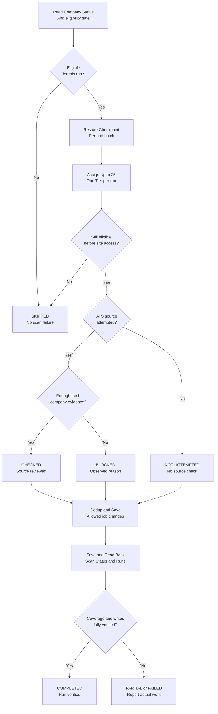

# Reliability, progress accounting and operational observability

The evolved hourly discovery runtime moved from broad roster attempts toward **bounded, persistent Tier batches**. The saved task policy assigns **at most 25 eligible companies in one Tier per hourly run** (A/B/C), persists cycle progress, prioritizes carryover incomplete assignments, and truthfully reports unreachable sites. The real Scan Runs table stores both COMPLETED and PARTIAL receipts.

## Scheduling and coverage

The visual distinguishes **ineligible skips**, **assigned-but-unattempted**, and **attempted-but-blocked** outcomes. Real run classification and write verification depend on observed evidence; this is a design illustration, not a live run trace.

## Explicit classifications

| Status | Meaning | Examples |
| --- | --- | --- |
| `CHECKED` | Fresh, company-specific current source was actually reviewed, including zero relevant jobs | Official ATS list retrieved and assessed |
| `BLOCKED` | Source attempt occurred, but company-specific evidence was insufficient | `ACCESS_DENIED`, `SOURCE_ERROR`, `DYNAMIC_CONTENT`, `RATE_LIMIT`, `TIMEOUT`, `INSUFFICIENT_EVIDENCE`, `TOOL_ERROR` |
| `NOT_ATTEMPTED` | Assigned eligible company was never meaningfully searched | Task budget expired before this company |
| `SKIPPED INELIGIBLE` | Not assigned due to user/company eligibility gate | Inactive; future Cooldown; malformed eligibility handled separately |

Do not count non-eligible companies as BLOCKED/NOT_ATTEMPTED or invent an HTTP failure for unvisited sites. An unsupported generic search snippet is not evidence of CHECKED.

## Run receipts and checkpoints

**Scan Runs** stores `Run ID`, `Run Time`, `Tier`, `Batch`, `Scheduled`, `Checked`, `Blocked`, `Not Attempted`, `New Added`, `Material Updates`, `Closed`, `Run Status`, and serialized `Coverage State`.

`Coverage State` identifies the scan cycle, tier order, assigned companies, next tier/batch and latest run. This persists progress across separate task executions; later invocations can restore rather than restarting at Tier A.

**Scan Status** stores `Last Check`, `Last Status`, `Failure Count`, `Last Failure`, `Reason Notes`, and `Last Counted Run ID`. Failure Count is cumulative BLOCKED + NOT_ATTEMPTED, not reset when the next scan succeeds. The stable last-counted run identifier is meant to prevent double-increment on retries.

A retry reuses a stable logical `Run ID` and should upsert the one receipt instead of multiplying run rows. It does not turn a partial batch into success until actual source retrieval and required writes pass readback.

## Failure and data consistency examples

**Blocked ATS / dynamic board:** Preserve existing job records; log DYNAMIC_CONTENT only if observed and retry on a later eligible run. Missing access is not evidence that a prior role closed.

**Partial execution budget:** If 25 were assigned but 14 checked, 7 blocked and 4 not attempted, the receipt must not claim 25 successful scans. Report remaining work and persist checkpoint.

**Write failure:** If Open Jobs append succeeded but Scan Runs receipt failed, report PARTIAL and verify persisted rows before retry. GitHub README messages or task output are not durable transaction logs.

**Duplicate detection:** Before any append, use the complete Open Jobs identity index and then refresh identifiers immediately before write. Upsert supported material differences; preserve First Seen and human statuses. Unknown job identity is held for review.

**Race / cross-system consistency:** Google Sheets edits, Google Docs export, Gmail labeling and chat notification cannot be a single atomic transaction. Use reconciliation and readback; do not claim exactly-once execution or delivery.

## Monitoring limitations and suggested metrics

Current status **does not prove** complete job universe coverage or notification delivery. Task prompts require a chat summary every run, but platform push/email notification toggles can be disabled independently. A saved prompt is not evidence that the report visibly arrived.

Potential *future computed* metrics:
- `scan coverage = sum(Checked) / sum(Scheduled eligible assigned)` over **unique** Run IDs and a documented interval
- per-tier completed-cycle latency, blocked rate, not-attempted rate and failure categories
- `duplicate suppression count` grounded in identity matches
- Gmail match precision against manually labeled examples; action-alert delivery
- real time saved, measured rather than estimated

**No measured availability, 100% coverage, exact-once semantics, or cost savings are claimed.**

See [synthetic run records](../examples/scan-runs.synthetic.json) and [known gaps](limitations-and-roadmap.md).
